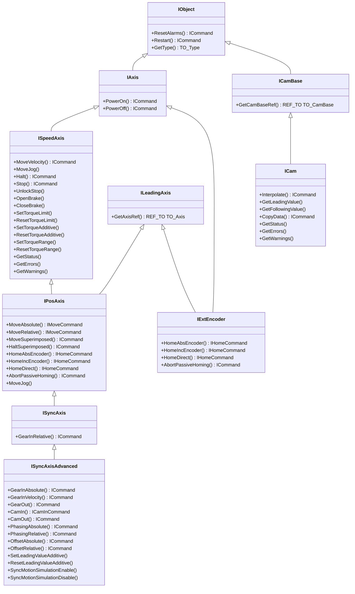

# @simatic-ax/motioncontrol-oop

## Description

The `Simatic.Ax.LAxisCtrl.Oop` library provides an Object-Oriented Programming (OOP) abstraction layer for SIMATIC S7-1500 and S7-1500T Motion Control within SIMATIC AX.

By encapsulating native SIMATIC Motion Control Technology Objects (`TO_SpeedAxis`, `TO_PositioningAxis`, `TO_SynchronousAxis`, `TO_ExternalEncoder`, `TO_Cam`, etc.) and their corresponding PLCopen motion control instructions, this library replaces complex edge-triggered function block call chains with an intuitive, modular class and interface hierarchy.

The following key functionalities are provided:

- **Unified Axis Hierarchy**: Incremental object-oriented interfaces (`IObject` &rarr; `IAxis` &rarr; `ISpeedAxis` &rarr; `IPosAxis` &rarr; `ISyncAxis` &rarr; `ISyncAxisAdvanced`) providing natural access to axis features based on capability.
- **Asynchronous Command Pattern**: Non-blocking methods (`PowerOn`, `MoveAbsolute`, `MoveRelative`, `MoveVelocity`, `GearInRelative`, `CamIn`, etc.) returning command handles (`ICommand`, `IMoveCommand`, `IHomeCommand`, `ICamInCommand`) that encapsulate command lifecycles (`Busy()`, `Done()`, `Aborted()`, `Error()`, `ErrorID()`).
- **Positioning & Speed Control**: Absolute, relative, and superimposed positioning, continuous and incremental jogging, velocity motion, and homing (active, passive, direct, and fixed stop).
- **Synchronous Operation & Camming**: Relative, absolute, and velocity gearing, desynchronization (`GearOut`, `CamOut`), dynamic phasing and offsets, cam interpolation, and leading/following value calculation.
- **External Encoders**: Position sensing and reference export as leading axes for synchronization.
- **Drive & Object Diagnostics**: Direct evaluation and decoding of status, error, and warning words, motor brake control, and torque limiting / additive torque via telegram 750.
- **Flexible Attachment**: Seamlessly attaches to existing Technology Objects via `Attach` with support for `DB_ANY` or typed `TO_*` references, enabling easy integration and testability (e.g. mocking in LLVM unit tests).

## Getting started

Pick the package matching your Motion Control version:

| Package | Motion Control version |
| --- | --- |
| `@simatic-ax/laxisctrl-oop-v10` | V10 |
| `@simatic-ax/laxisctrl-oop-v9` | V9 |

Install with Apax:

> If not yet done login to the GitHub registry first.
> More information you'll find in the [GitHub Personal Access Token guide](https://github.com/simatic-ax/.github/blob/main/docs/personalaccesstoken.md).

```cli
apax add @simatic-ax/laxisctrl-oop-v10
```

Add the namespace in your ST code:

```iec-st
USING Simatic.Ax.LAxisCtrl.Oop;
```

## Library functionality

The library is organized into modular objects representing the same Technology Objects and capabilities of SIMATIC Motion Control:

### Technology Objects & Axis Classes

| Interface / Class | Description |
| :---------------- | :---------- |
| [`IObject`](docs/technology_objects/object/index.md) | Foundational base interface for all motion Technology Objects. Provides alarm reset, restart, and type identification. |
| [`IAxis`](docs/technology_objects/axis/index.md) | Base contract for motion axes. Provides basic power control (`PowerOn`, `PowerOff`). |
| [`ISpeedAxis`](docs/technology_objects/speed_axis/index.md) / [`SpeedAxis`](docs/technology_objects/speed_axis/index.md) | Velocity-controlled motion axis (`TO_SpeedAxis`). Provides velocity motion, halting, stopping, holding brake control, and torque limits. |
| [`IPosAxis`](docs/technology_objects/pos_axis/index.md) / [`PosAxis`](docs/technology_objects/pos_axis/index.md) | Position-controlled motion axis (`TO_PositioningAxis`). Adds absolute/relative/superimposed positioning, homing modes, and jogging. |
| [`ISyncAxis`](docs/technology_objects/synchronous_axis/index.md) / [`SyncAxis`](docs/technology_objects/synchronous_axis/index.md) | Synchronous motion axis (`TO_SynchronousAxis`). Inherits positioning capabilities and adds relative gear coupling (`GearInRelative`). |
| [`ISyncAxisAdvanced`](docs/technology_objects/synchronous_axis_advanced/index.md) / [`SyncAxisAdvanced`](docs/technology_objects/synchronous_axis_advanced/index.md) | Advanced synchronous axis. Adds absolute gearing, velocity gearing, camming (`CamIn`/`CamOut`), phasing, and leading value offsets. |
| [`IExtEncoder`](docs/technology_objects/external_encoder/index.md) / [`ExtEncoder`](docs/technology_objects/external_encoder/index.md) | External encoder Technology Object (`TO_ExternalEncoder`). Provides external position detection, homing, and leading axis reference export. |
| [`ICam`](docs/technology_objects/cam/index.md) / [`Cam`](docs/technology_objects/cam/index.md) | Cam Technology Object (`TO_Cam`, `TO_Cam_10k`, etc.). Provides cam interpolation, leading/following value evaluation, and dataset copying. |

### Capability Interface

| Interface | Description |
| :-------- | :---------- |
| [`ILeadingAxis`](docs/common/ILeadingAxis.md) | Interface implemented by Technology Objects (`PosAxis`, `SyncAxis`, `ExtEncoder`) capable of supplying master position/velocity values for synchronous operations. |

### Command Handles

All asynchronous methods return command handles implementing `ICommand` or extended command interfaces:

| Interface | Description |
| :-------- | :---------- |
| [`ICommand`](docs/common/commands/ICommand.md) | Core command interface providing `Busy()`, `Done()`, `Aborted()`, `Error()`, and `ErrorID()`. |
| [`IMoveCommand`](docs/common/commands/IMoveCommand.md) | Returned by movement operations (`MoveAbsolute`, `MoveRelative`). Adds `Active()`. |
| [`IHomeCommand`](docs/common/commands/IHomeCommand.md) | Returned by homing operations (`HomeAbsEncoder`, `HomeIncEncoder`, `HomeDirect`). Adds `ReferenceMarkPosition()`. |
| [`ICamInCommand`](docs/common/commands/ICamInCommand.md) | Returned by camming operations (`CamIn`). Adds `EndOfProfile()`. |

## Architecture

The library employs interface segregation and progressive inheritance. Each interface layer exposes only the methods supported by that level of axis or Technology Object capability:

<details>
<summary>Interface Hierarchy</summary>



</details>

## Technology Object Binding

Before issuing commands, each class instance must be bound to its corresponding Technology Object:

```iec-st
PROGRAM Sample
    VAR_EXTERNAL
        PosAxis_1 : TO_PositioningAxis;
    END_VAR

    VAR
        _axis : PosAxis;
    END_VAR

    _axis.Attach(PosAxis_1); // accepts TO_PositioningAxis, TO_SynchronousAxis, or DB_ANY
END_PROGRAM
```

The `Attach` method resolves and stores references to the underlying data block and validates object type compatibility. For unit testing on simulated/LLVM targets, the abstraction also permits reference injection and mocking.

When a Technology Object is not needed for a specific instance anymore, it can be unbound:

```iec-st
PROGRAM Sample
    VAR_EXTERNAL
        PosAxis_1 : TO_PositioningAxis;
    END_VAR

    VAR
        _axis : PosAxis;
    END_VAR

    _axis.Detach(); // Frees the previously attached Technology Object
END_PROGRAM
```

The `Detach` method clears the assigned Technology Object reference from the instance. While optional, detaching helps prevent ambiguous or conflicting calls to the same Technology Object and enforces clear single-instance ownership.

## Examples

### Position Axis Control

The following example demonstrates attaching to a positioning axis, enabling power, commanding an absolute move, and monitoring command execution.

<details>
<summary>Open Example</summary>

```iec-st
USING Simatic.Ax.LAxisCtrl.Oop;
USING Siemens.S7.MotionControl; 

PROGRAM SamplePosAxis
    VAR_INPUT
        enablePower : BOOL;
        startMove : BOOL;
        targetPosition : LREAL := 250.0;
        targetVelocity : LREAL := 50.0;
    END_VAR

    VAR_OUTPUT
        axisPowered : BOOL;
        moveBusy : BOOL;
        moveDone : BOOL;
        hasError : BOOL;
        errorID : WORD;
    END_VAR

    VAR_EXTERNAL
        PosAxis_1 : TO_PositioningAxis;
    END_VAR

    VAR
        _axis : PosAxis;
        _isAttached : BOOL;
        _powerCmd : ICommand;
        _moveCmd : IMoveCommand;
    END_VAR

    // 1. Attach to Technology Object
    IF NOT _isAttached THEN
        _isAttached := _axis.Attach(PosAxis_1);
    END_IF;

    IF _isAttached THEN
        // 2. Power on axis
        IF enablePower AND (_powerCmd = NULL OR NOT _powerCmd.Busy()) THEN
            _powerCmd := _axis.PowerOn(positionControlled := TRUE);
        ELSIF NOT enablePower AND _powerCmd <> NULL AND NOT _powerCmd.Busy() THEN
            _powerCmd := _axis.PowerOff();
        END_IF;

        // 3. Trigger absolute positioning
        IF startMove AND (_moveCmd = NULL OR NOT _moveCmd.Busy()) THEN
            _moveCmd := _axis.MoveAbsolute(
                position := targetPosition,
                velocity := targetVelocity
            );
        END_IF;

        // 4. Poll command statuses (ExecuteIfBusy runs internally during queries)
        IF _powerCmd <> NULL THEN
            axisPowered := _powerCmd.Done();
            IF _powerCmd.Error() THEN
                hasError := TRUE;
                errorID := _powerCmd.ErrorID();
            END_IF;
        END_IF;

        IF _moveCmd <> NULL THEN
            moveBusy := _moveCmd.Busy();
            moveDone := _moveCmd.Done();
            IF _moveCmd.Error() THEN
                hasError := TRUE;
                errorID := _moveCmd.ErrorID();
            END_IF;
        END_IF;
    END_IF;
END_PROGRAM
```

</details>

### Synchronous Axis Gearing

The following example demonstrates coupling a slave synchronous axis to a master positioning axis using relative gearing:

<details>
<summary>Open Example</summary>

```iec-st
USING Simatic.Ax.LAxisCtrl.Oop;
USING Siemens.S7.MotionControl; 

PROGRAM SampleGearing
    VAR_INPUT
        coupleAxes : BOOL;
        gearRatioNum : DINT := 1;
        gearRatioDenom : DINT := 1;
    END_VAR

    VAR_OUTPUT
        gearingActive : BOOL;
        gearError : BOOL;
        gearErrorID : WORD;
    END_VAR

    VAR_EXTERNAL
        MasterAxis : TO_PositioningAxis;
        SlaveAxis : TO_SynchronousAxis;
    END_VAR

    VAR
        _master : PosAxis;
        _slave : SyncAxis;
        _attached : BOOL;
        _gearCmd : ICommand;
    END_VAR

    // 1. Attach axes
    IF NOT _attached THEN
        _attached := _master.Attach(MasterAxis) AND _slave.Attach(SlaveAxis);
    END_IF;

    IF _attached THEN
        // 2. Engage relative gear coupling
        IF coupleAxes AND (_gearCmd = NULL OR NOT _gearCmd.Busy()) THEN
            _gearCmd := _slave.GearInRelative(
                leadingAxis := _master,
                ratioNumerator := gearRatioNum,
                ratioDenominator := gearRatioDenom,
                acceleration := LREAL#-1.0,
                deceleration := LREAL#-1.0,
                jerk := LREAL#-1.0
            );
        END_IF;

        // 3. Monitor gear command status
        IF _gearCmd <> NULL THEN
            gearingActive := _gearCmd.Done();
            gearError := _gearCmd.Error();
            IF gearError THEN
                gearErrorID := _gearCmd.ErrorID();
            END_IF;
        END_IF;
    END_IF;
END_PROGRAM
```

</details>

## Unsupported MC instructions

The following MC instructions are not implemented in this library yet:

- [MC_SetSensor](https://docs.industrial-operations-x.siemens.cloud/r/en-us/ax-mc/s7-motioncontrol-docs/11.0.27/instructions/mc_setsensor)
- [MC_SetAxisSTW](https://docs.industrial-operations-x.siemens.cloud/r/en-us/ax-mc/s7-motioncontrol-docs/11.0.27/instructions/mc_setaxisstw)
- [MC_WriteParameter](https://docs.industrial-operations-x.siemens.cloud/r/en-us/ax-mc/s7-motioncontrol-docs/11.0.27/instructions/mc_writeparameter)
- [MC_SaveAbsoluteEncoderData](https://docs.industrial-operations-x.siemens.cloud/r/en-us/ax-mc/s7-motioncontrol-docs/11.0.27/instructions/mc_saveabsoluteencoderdata)
- [Output Cam & Measuring Input Instructions](https://docs.industrial-operations-x.siemens.cloud/r/en-us/ax-mc/s7-motioncontrol-docs/11.0.27/instructions/output-cam-measuring-input-instructions)
- [MotionIn](https://docs.industrial-operations-x.siemens.cloud/r/en-us/ax-mc/s7-motioncontrol-docs/11.0.27/instructions/motionin-instructions)
- [MC_PositionProfile](https://docs.industrial-operations-x.siemens.cloud/r/en-us/ax-mc/s7-motioncontrol-docs/11.0.27/instructions/mc_positionprofile-v10)
- [MC_SetCamRangeScaling](https://docs.industrial-operations-x.siemens.cloud/r/en-us/ax-mc/s7-motioncontrol-docs/11.0.27/instructions/cam-instructions/mc_setcamrangescaling-v10)
- [Kinematics Instructions](https://docs.industrial-operations-x.siemens.cloud/r/en-us/ax-mc/s7-motioncontrol-docs/11.0.27/instructions/kinematics-instructions)

## Motion Control Documentation

For in-depth information about SIMATIC S7-1500 and S7-1500T Motion Control concepts, configuration, and PLCopen motion instructions, refer to the official Siemens documentation:

- [Siemens.S7.MotionControl - Technology Object](https://docs.industrial-operations-x.siemens.cloud/r/en-us/ax-mc/s7-motioncontrol-docs/11.0.27/technology-objects/description-of-technology-objects)
- [Siemens.S7.MotionControl - Motion Control Instructions for Axis Control](https://docs.industrial-operations-x.siemens.cloud/r/en-us/ax-mc/s7-motioncontrol-docs/11.0.27/instructions/motion-control-instructions-for-axis-control)
- [Siemens.S7.MotionControl - Motion Control Instructions for Synchronous Operation](https://docs.industrial-operations-x.siemens.cloud/r/en-us/ax-mc/s7-motioncontrol-docs/11.0.27/instructions/synchronous-motion)
- [Siemens.S7.MotionControl - Motion Control Instructions for Cam Operation](https://docs.industrial-operations-x.siemens.cloud/r/en-us/ax-mc/s7-motioncontrol-docs/11.0.27/instructions/cam-instructions)
- [Siemens.S7.MotionControl - Motion Control Instructions for Torque Control](https://docs.industrial-operations-x.siemens.cloud/r/en-us/ax-mc/s7-motioncontrol-docs/11.0.27/instructions/torque-instructions)

## Contribution

Thanks for your interest in contributing. Anybody is free to report bugs, unclear documentation, and other problems regarding this repository in the Issues section or, even better, is free to propose any changes to this repository using a pull request.

## License and Legal information

Please read the [Legal information](LICENSE)
